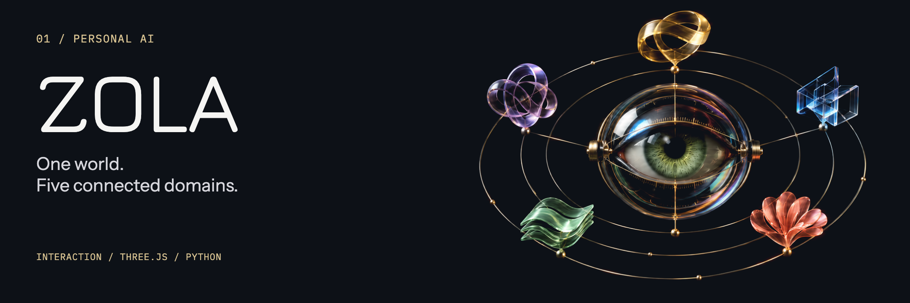
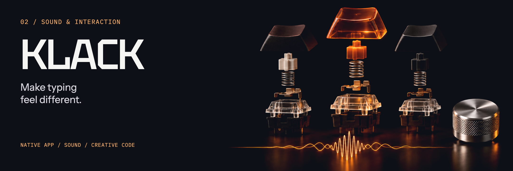
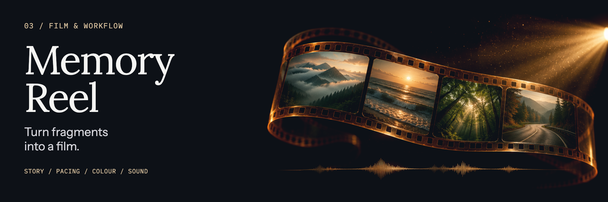

  

# AI builder × creative designer

I'm **Vinay Pathak**. I combine art direction, motion, 3D and code to turn ideas into working experiences—from expressive websites and films to small tools that make everyday life more interesting.

My practice spans brand, content, interfaces and design systems. AI is part of how I explore and build; the creative direction, design decisions and care for the final experience are mine.

**[Explore my portfolio ↗](https://11vinaypathak-sys.github.io/portfolio/)** &nbsp; · &nbsp; [LinkedIn](https://www.linkedin.com/in/1vinaypathak) &nbsp; · &nbsp; [Behance](https://www.behance.net/1vinaypathak)

---

## Selected builds

*AI-assisted editorial cover art. Follow the project links for actual interfaces, demos and source.*

### 01 / ZOLA — a world for personal AI

An exploration of how personal information, rules and AI can come together in one interface. Five domains surround a central eye, opening into individual instruments.

**My focus:** product concept, visual identity, 3D interaction, interface design and AI-assisted implementation. The public showcase uses example data; the private local system is separate.

`Interactive design` · `Three.js` · `Python` · `AI workflows`

**[Enter the world ↗](https://11vinaypathak-sys.github.io/zola-showoff/world.html)** · [Explore the code](https://github.com/11vinaypathak-sys/zola-showoff) · [Interface screenshot](https://github.com/11vinaypathak-sys/zola-showoff/blob/main/docs/hero/overview.jpg)

### 02 / Klack — make typing feel different

A macOS menu-bar app that adds mechanical-keyboard sounds to typing, with sound packs and a live synthesis mixer. A small utility treated as a complete sensory experience.

**My focus:** interface art direction, interaction and sound experience, developed with Claude. Source and a public demo are available; a signed installer is not currently published.

`Native app` · `Sound design` · `Swift` · `Creative coding`

**[See and hear it ↗](https://11vinaypathak-sys.github.io/klack/)** · [Explore the code](https://github.com/11vinaypathak-sys/klack) · [App screenshot](https://github.com/11vinaypathak-sys/klack/blob/main/docs/images/panel.png)

### 03 / Cinematic Memory Reel — craft, made reusable

A reusable AI editing workflow for shaping footage and photographs into short films: story, pacing, colour, scene-matched sound and checks on the actual export.

**My focus:** translating creative judgement into a practical skill, a pasteable workflow and local verification tools. Bring your own media and editing tools.

`Motion & storytelling` · `AI skill design` · `Production workflow`

**[Explore the workflow ↗](https://github.com/11vinaypathak-sys/cinematic-memory-reel-skill)** · [Try the prompt](https://github.com/11vinaypathak-sys/cinematic-memory-reel-skill/blob/main/PROMPT.md)

---

## The way I build

**Start with a feeling.** What should someone understand, notice or enjoy?

**Make it tangible.** Move between visual exploration, prototypes and working code.

**Check the real thing.** Review the rendered image, the interaction, the sound and the exported file—not just the idea.

My toolkit includes **Figma, Adobe Creative Cloud, Blender, Three.js, Python, Swift and AI-assisted development**. The project decides which tools belong.

## Let's make something worth opening

Interested in **AI designer, creative technologist and founding designer** opportunities—especially where visual craft and working prototypes matter together.

Based in **Delhi NCR** · Open to India-based and India-eligible remote opportunities.

[Portfolio](https://11vinaypathak-sys.github.io/portfolio/) · [LinkedIn](https://www.linkedin.com/in/1vinaypathak) · [Behance](https://www.behance.net/1vinaypathak)
